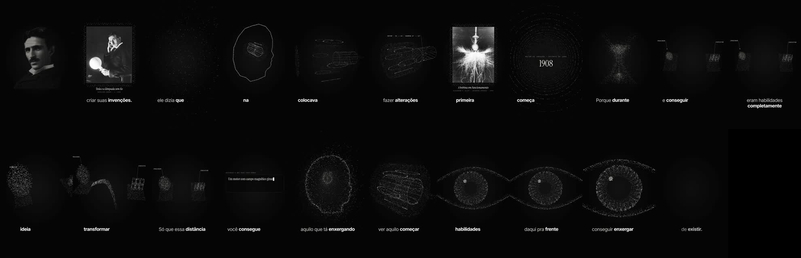

# BRABO · Vídeo minimalista em pontilhismo

> Um roteiro narrado vira uma viagem visual: milhares de pontos desenham, se transformam e conduzem o olhar — do retrato do protagonista a objetos 3D, metáforas e obras históricas. Preto e branco. Vertical. Feito em código com [Remotion](https://www.remotion.dev).



Skill para agentes de IA (Claude Code, Claude Desktop e compatíveis com `SKILL.md`). Você entrega um roteiro e a narração; o agente transcreve a fala, pesquisa imagens, pergunta a cada frase *"o que a pessoa precisa ver?"*, desenha tudo em pontos e renderiza.

## Como funciona

```
roteiro ─► narração ─► tempo de cada palavra ─► storyboard (1 ideia = 1 forma)
        ─► pontos (retrato + formas 3D) ─► câmera ─► legenda ─► render
```

## Requisitos

- **Node 18+** e **ffmpeg** no PATH.
- **Narração — escolha um caminho:**
  - **A) Automática:** conecte o **MCP da ElevenLabs** ao seu agente (com sua conta e sua voz/clone). O agente gera a narração a partir do roteiro.
  - **B) Manual:** grave você mesmo e entregue o `.mp3`/`.wav`. O agente transcreve e sincroniza tudo com a sua fala.
- A transcrição por palavra roda **localmente** (whisper.cpp, instalado automaticamente na primeira vez).

## Instalação

1. Copie esta pasta para a pasta de skills do seu agente (ex.: `~/.claude/skills/brabo-minimalista-pontilhismo`).
2. Peça ao agente: *"Crie um vídeo minimalista em pontilhismo com este roteiro: …"*.

Para usar sem agente, comece pelo [template](template/):

```bash
cp -r template meu-video && cd meu-video
npm install
npm run palavras        # transcreve public/narracao.mp3 → src/data/words.json
npm run studio          # edite src/World.tsx (FORMAS, CHAVES, CAMERAS)
npm run render
```

## Estrutura

| Pasta | Conteúdo |
|---|---|
| [`SKILL.md`](SKILL.md) | Instruções para o agente: fluxo, regras da estética, erros comuns |
| [`references/`](references/) | Narração, método de ilustração, motor de partículas, imagens e créditos, legenda, revisão, render |
| [`scripts/`](scripts/) | `transcrever-palavras` · `inserir-respiros` · `imagem-para-pontos` · `contact-sheet` |
| [`template/`](template/) | Projeto Remotion inicial: mundo 3D de pontos + câmera + legenda + obra com moldura |
| [`exemplos/`](exemplos/) | 4 vídeos completos: Tesla, Sócrates, Ponto Azul (Three.js), Jobs |

## A estética em 8 regras

1. Preto e branco — fundo `#050505`, pontos `#EDEBE6`.
2. Um único sistema de partículas que morfa o vídeo inteiro.
3. O protagonista em pontilhismo, formado em menos de 1 s.
4. Cada frase ganha a ilustração que explica o seu verbo.
5. Câmera viva num mundo 3D (órbita, aproximação, mergulho).
6. Obras históricas com momento próprio e moldura de partículas + crédito.
7. Legenda Inter palavra por palavra, palavra falada em bold, a ~380 px da base.
8. Final em loop: a câmera mergulha e o vídeo termina no preto.

## Licença

Código e documentação: [MIT](LICENSE). Imagens dos exemplos: licenças das fontes originais — ver [exemplos/README.md](exemplos/README.md).

Criado por **Fernando Araújo** · BRABO.
