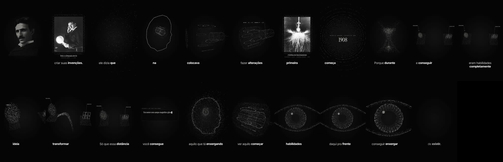
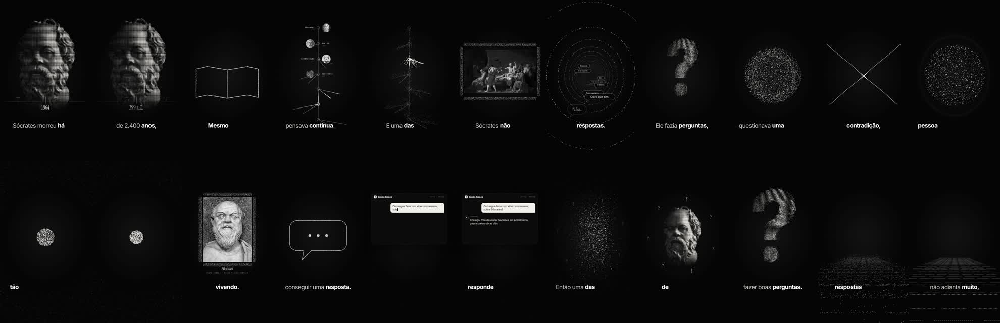
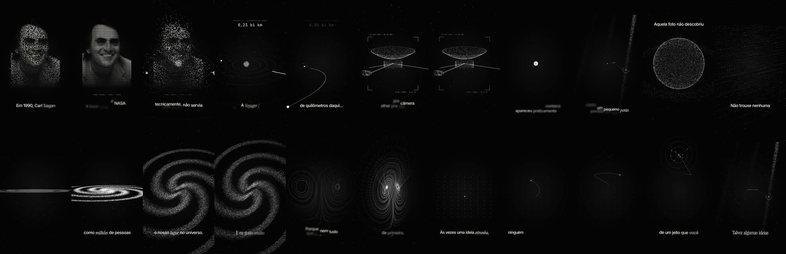
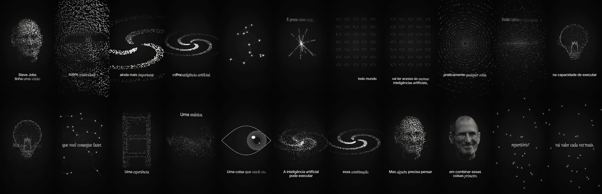

# Exemplos de referência

Quatro vídeos completos (código + dados de pontos + imagens). Rode cada um com `npm install` e `npm run studio` dentro da pasta.
**As narrações originais não estão incluídas** (voz pessoal do autor) — coloque a sua em `public/` com o mesmo nome referenciado no `index.tsx` ou gere uma nova.

| # | Vídeo | O que estudar | Prévia |
|---|---|---|---|
| 01 | **Tesla · antes de existir** | Mundo 3D com câmera (órbita, vista explodida, mergulho), objeto protagonista (motor de indução) atravessando a história, rótulos que seguem a câmera, olho vivo e final em loop |  |
| 02 | **Sócrates · boas perguntas** | Um único sistema de pontos morfando ideia a ideia (busto → livro → linhagem → "?" → certeza que racha → contradição…), obras com moldura de partículas, legenda padrão |  |
| 03 | **O Pálido Ponto Azul** | Three.js (`@remotion/three`): Terra com continentes reais, sistema solar, sonda Voyager, galáxia de 60 mil pontos, projeção 3D→2D para rótulos |  |
| 04 | **Steve Jobs · repertório** | Biblioteca de formas 2D (galáxia, rede viva com pulsos, túnel, lâmpada, filme, montanha, ondas, olho com reflexo) e morphs rápidos |  |

> O exemplo 04 é anterior ao padrão de legenda atual (usa blocos com blur). Para vídeos novos, use `template/src/Legenda.tsx`.

## Créditos das imagens

Confira sempre a página de origem no Wikimedia Commons antes de republicar — as licenças abaixo são as indicadas nas fichas no momento do download.

**01 · Tesla**
- Retrato c. 1890 — Napoleon Sarony — domínio público (convertido em pontos).
- Tesla com a lâmpada — arquivo "Nikola Tesla by Sarony c1898.jpg" — domínio público (PD-US).
- Laboratório de Colorado Springs, dupla exposição, 1899 — Dickenson V. Alley, Wellcome Collection, restauração por Bammesk — **CC BY 4.0** (creditar).
- Bobina em funcionamento — Dickenson V. Alley, 1899 — domínio público.

**02 · Sócrates**
- Busto de Sócrates, Museu do Louvre (foto Wikimedia "Socrates Louvre.jpg") — ver licença na ficha (creditar o fotógrafo).
- Busto de Sócrates, Museu Pio-Clementino — ver ficha.
- *A Morte de Sócrates*, Jacques-Louis David, 1787 — domínio público.
- *A Escola de Atenas*, Rafael, 1509–1511 — domínio público.
- Retratos de Platão, Aristóteles, Agostinho, Tomás de Aquino e Descartes (Frans Hals) — ver fichas individuais.

**03 · Ponto Azul**
- Carl Sagan (Planetary Society) — NASA/JPL — domínio público.
- *Pale Blue Dot*, Voyager 1, 1990 — NASA/JPL — domínio público.
- Mapa da Terra (Land/Ocean/Ice) — NASA — domínio público.

**04 · Jobs**
- Steve Jobs, 2010 — Matthew Yohe — **CC BY-SA 3.0** (creditar; convertido em pontos).
